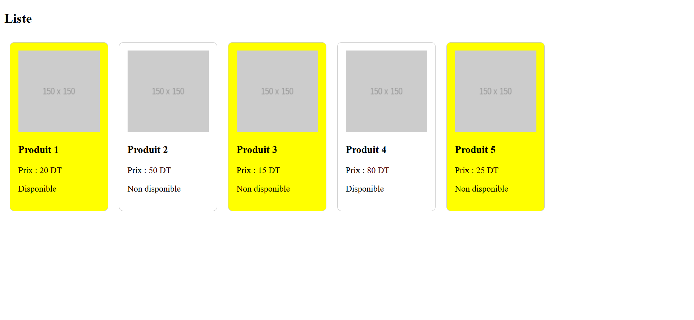

# 📦 TP Angular — Liste de Produits

> **Travaux Pratiques — 2ème Année** | Angular 18 | Composants Standalone


---

## 📋 Description

Application Angular qui affiche une **liste de 5 produits** sous forme de cartes interactives.  
Chaque carte produit montre l'image, le nom, le prix (avec couleur dynamique) et le statut de disponibilité.

Le projet met en pratique les concepts clés d'Angular 18 :
- ✅ Composants **Standalone**
- ✅ Liaison de propriétés avec **`@Input()`**
- ✅ Directives **`ngClass`** et **`ngStyle`**
- ✅ Syntaxe de contrôle moderne **`@if` / `@else`** et **`@for`**

---

## 🖼️ Aperçu



---

## 🗂️ Structure du Projet

```
Liste/
├── src/
│   ├── app/
│   │   ├── product/                     # Composant enfant (carte produit)
│   │   │   ├── product.component.ts     # Logique + @Input() props
│   │   │   ├── product.component.html   # Template avec directives
│   │   │   └── product.component.scss   # Styles + classe .promo
│   │   ├── app.component.ts             # Composant racine + tableau produits
│   │   ├── app.component.html           # Boucle @for + <app-product>
│   │   └── app.component.scss
│   ├── index.html
│   └── styles.scss
├── package.json
└── README.md
```

---

## ⚙️ Technologies Utilisées

| Technologie | Version | Rôle |
|---|---|---|
| **Angular** | 18.2 | Framework principal |
| **TypeScript** | ~5.5 | Langage typé |
| **SCSS** | — | Styles des composants |
| **Angular SSR** | 18.2.21 | Rendu côté serveur |
| **Node.js** | ≥18 | Environnement d'exécution |

---

## 🚀 Lancement du Projet

### 1. Installer les dépendances

```bash
npm install
```

### 2. Démarrer le serveur de développement

```bash
ng serve
```

> L'application sera disponible sur **[http://localhost:4200](http://localhost:4200)**

### 3. Build de production

```bash
ng build
```

---

## 🧩 Architecture des Composants

```
AppComponent (app-root)
│
└── ProductComponent (app-product)  ×5
    ├── @Input() name: string
    ├── @Input() price: number
    ├── @Input() imageUrl: string
    └── @Input() available?: boolean  (optionnel)
```

---

## 📁 Détail des Fichiers

### `src/app/product/product.component.ts`

Composant **Standalone** qui reçoit les données d'un produit via des propriétés `@Input()`.

```typescript
import { Component, Input } from '@angular/core';
import { CommonModule } from '@angular/common';

@Component({
  selector: 'app-product',
  standalone: true,
  imports: [CommonModule],
  templateUrl: './product.component.html',
  styleUrl: './product.component.scss'
})
export class ProductComponent {
  @Input() name!: string;
  @Input() price!: number;
  @Input() imageUrl!: string;
  @Input() available?: boolean;   // ← optionnel (peut être undefined)
}
```

**Points clés :**
- `standalone: true` → pas besoin de `NgModule`
- `!` (non-null assertion) sur les propriétés obligatoires
- `?` (optional) sur `available` car certains produits n'ont pas ce champ

---

### `src/app/product/product.component.html`

Template de la carte produit avec les directives Angular :

```html
<div class="product-card" [ngClass]="{'promo': price < 30}">
  

  <h3>{{ name }}</h3>
  <p>
    Prix :
    <span [ngStyle]="{'color': 'rgb(' + price + ',0,0)'}">
      {{ price }} DT
    </span>
  </p>
  <p>
    @if (available === true) {
      <span>Disponible</span>
    } @else {
      <span>Non disponible</span>
    }
  </p>
</div>
```

**Directives utilisées :**

| Directive | Utilisation | Effet |
|---|---|---|
| `[ngClass]` | `{'promo': price < 30}` | Fond **jaune** si prix < 30 DT |
| `[ngStyle]` | `{'color': 'rgb(price,0,0)'}` | Couleur **rouge variable** selon le prix |
| `@if / @else` | `available === true` | Affiche "Disponible" ou "Non disponible" |

> ⚠️ La condition `available === true` (triple égal) gère aussi le cas `undefined` : si la propriété est absente, le produit affiche "Non disponible".

---

### `src/app/product/product.component.scss`

```scss
.product-card {
  border: 1px solid #ccc;
  padding: 15px;
  margin: 10px;
  border-radius: 8px;
  display: inline-block;
}

/* Appliqué automatiquement par [ngClass] si price < 30 */
.promo {
  background-color: yellow;
}
```

---

### `src/app/app.component.ts`

Composant racine qui déclare le tableau des 5 produits et importe `ProductComponent`.

```typescript
import { Component } from '@angular/core';
import { RouterOutlet } from '@angular/router';
import { ProductComponent } from './product/product.component';

@Component({
  selector: 'app-root',
  standalone: true,
  imports: [RouterOutlet, ProductComponent],
  templateUrl: './app.component.html',
  styleUrl: './app.component.scss'
})
export class AppComponent {
  title = 'Liste';

  products = [
    { name: 'Produit 1', price: 20,  imageUrl: 'https://via.placeholder.com/150', available: true  },
    { name: 'Produit 2', price: 50,  imageUrl: 'https://via.placeholder.com/150', available: false },
    { name: 'Produit 3', price: 15,  imageUrl: 'https://via.placeholder.com/150' },  // available non défini
    { name: 'Produit 4', price: 80,  imageUrl: 'https://via.placeholder.com/150', available: true  },
    { name: 'Produit 5', price: 25,  imageUrl: 'https://via.placeholder.com/150' }   // available non défini
  ];
}
```

**Résumé du tableau produits :**

| Produit   | Prix | Promo (< 30 DT) | Disponible |
|-----------|------|-----------------|------------|
| Produit 1 | 20 DT | ✅ Fond jaune   | ✅ Oui     |
| Produit 2 | 50 DT | ❌              | ❌ Non     |
| Produit 3 | 15 DT | ✅ Fond jaune   | ❌ Non (undefined) |
| Produit 4 | 80 DT | ❌              | ✅ Oui     |
| Produit 5 | 25 DT | ✅ Fond jaune   | ❌ Non (undefined) |

---

### `src/app/app.component.html`

Template racine qui boucle sur le tableau et passe chaque produit au composant enfant.

```html
<h2>{{ title }}</h2>

<div class="product-container">
  @for (p of products; track p.name) {
    <app-product
      [name]="p.name"
      [price]="p.price"
      [imageUrl]="p.imageUrl"
      [available]="p.available">
    </app-product>
  }
</div>
```

**Points clés :**
- `@for` → **nouvelle syntaxe Angular 17+** (remplace `*ngFor`)
- `track p.name` → optimise le rendu en identifiant chaque élément par son nom
- Les `[brackets]` → **property binding** pour passer les données au composant enfant

---

## 🔑 Concepts Angular Pratiqués

### 1. Property Binding `[ ]`
Passer des données d'un composant parent à un composant enfant :
```html
<app-product [name]="p.name" [price]="p.price" ...></app-product>
```

### 2. `@Input()` Decorator
Recevoir des données depuis le composant parent :
```typescript
@Input() name!: string;       // obligatoire
@Input() available?: boolean; // optionnel
```

### 3. `ngClass` — Classe conditionnelle
```html
[ngClass]="{'promo': price < 30}"
<!-- Si price < 30 → ajoute la classe CSS 'promo' -->
```

### 4. `ngStyle` — Style dynamique
```html
[ngStyle]="{'color': 'rgb(' + price + ',0,0)'}"
<!-- La couleur rouge varie selon la valeur du prix -->
```

### 5. `@if / @else` — Rendu conditionnel (Angular 17+)
```html
@if (available === true) {
  <span>Disponible</span>
} @else {
  <span>Non disponible</span>
}
```

### 6. `@for` — Boucle de rendu (Angular 17+)
```html
@for (p of products; track p.name) {
  <!-- Rendu pour chaque produit -->
}
```

---

## 👨‍💻 Auteur

**Étudiant :** 2ème Année  
**Matière :** Développement Web — Angular  
**TP :** Liste de Produits avec Composants Standalone  
**Date :** 2026

---

*Projet réalisé dans le cadre du cours Angular — 2ème Année.*
